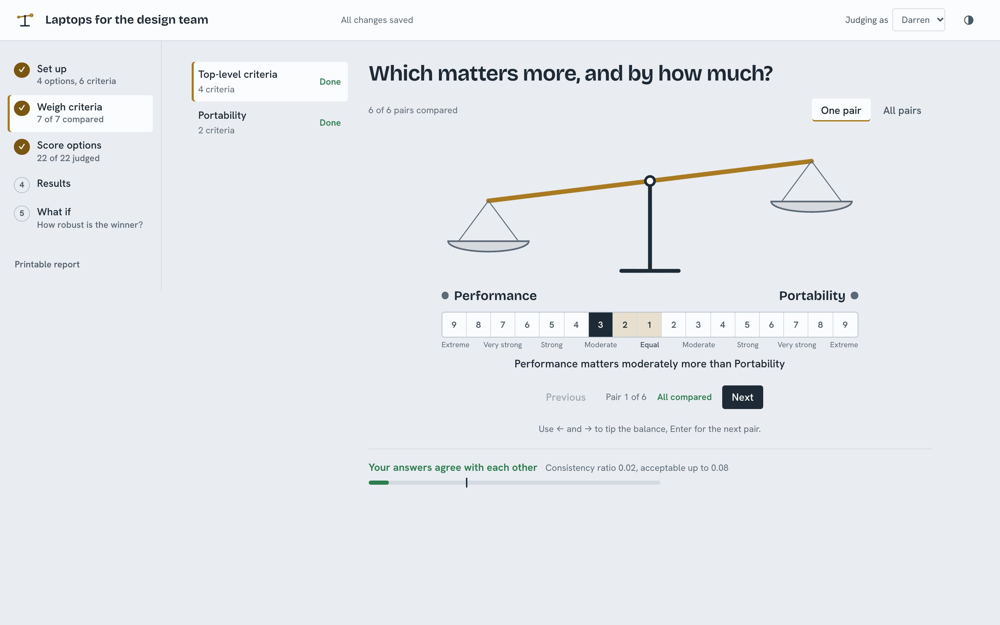
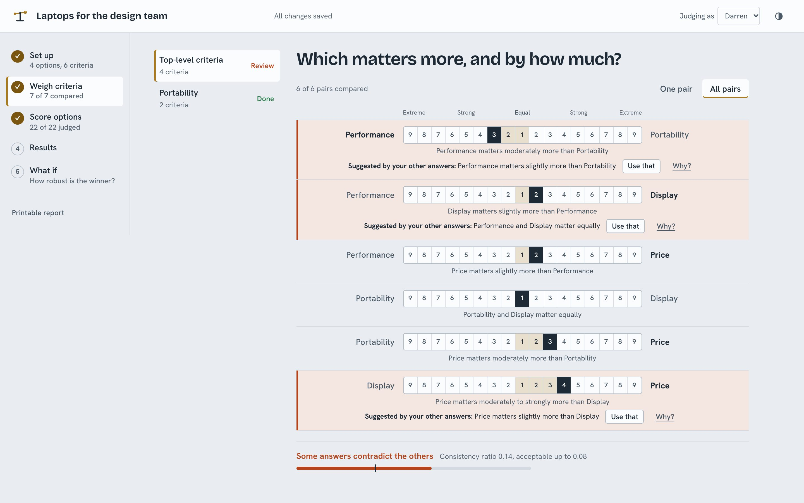
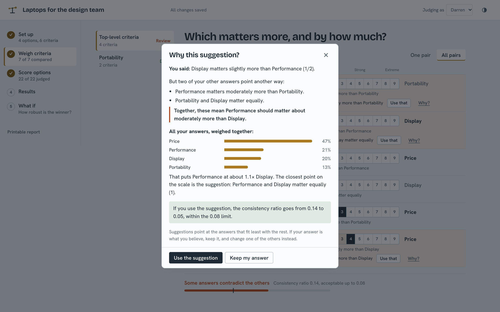
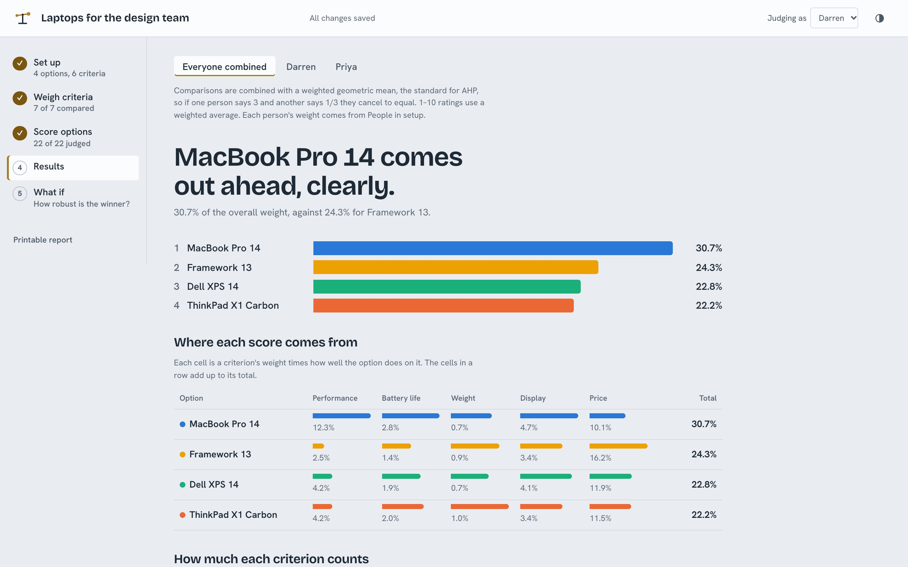

# AHP Matrix

Make better decisions with the [Analytic Hierarchy Process](https://en.wikipedia.org/wiki/Analytic_hierarchy_process) (AHP):
compare your options two at a time, check that your judgments agree with each other, and see how robust the winner is.
AHP Matrix is a single binary that runs a local web app. No account, no cloud: each decision is a `.ahp.json` file on your machine.

## How it works

1. **List the options** you're choosing between and **what matters** to you, grouping related criteria if you like.
2. **Compare them two at a time.** Which matters more, and by how much? Which option is better on each criterion?
3. **Check your consistency.** AHP can tell when your answers contradict each other, and the app shows you which ones and why.
4. **See the result,** where each score comes from, and how much the winner depends on your weights.

## Compare one pair at a time…



The balance tips toward the side you prefer. The scale is labeled from Equal to Extreme on both sides, every choice is spelled
out in a sentence, and pointing at a number previews what it would mean. Arrow keys move it; Enter goes to the next pair.
You get useful results long before every pair is answered.

## …or weigh every pair on one screen



**All pairs** lists each comparison once, each with the same control, so you can review and adjust everything in one place.
The side you favor is in bold, and the shading shows how far each answer leans. When some answers contradict the others,
exactly those rows are flagged with a suggested value.

## Contradictions, explained



Every suggestion has a **Why?** that walks through your own answers: the two that conflict with the flagged one, what all your
answers imply when weighed together, and what the consistency ratio would be if you took the suggestion. Suggestions are hints,
never overrides: if your answer is what you believe, keep it and change another.

## Results



The winner and the full ranking, where each score comes from, how much each criterion counts, and a what-if view for testing
how robust the winner is.

## Features

- **Pairs, ratings or measurements.** Each criterion can be compared in pairs, rated 1–10, or given measured values such as price ("lower is better").
- **Grouped criteria,** so you only compare criteria that belong together.
- **Several people.** Everyone judges separately; results combine them with a weighted geometric mean (the AHP standard, so opposite answers cancel to equal) and show where people disagree most. Send someone their own copy, then merge it back when they return it.
- **What if?** Drag a criterion's weight and watch the ranking change. Each criterion shows how far it can move before the winner changes.
- **Bring your spreadsheet.** Import workbooks made with the classic "Priority Matrix" Excel template, and export results to Excel or CSV.
- **Examples and templates** to start from, including vendor selection with the spreadsheet's 23 criteria, grouped.
- **Printable report,** light and dark themes, keyboard-friendly, works on a phone.

## Install

Download the archive for your system from the [latest release](https://github.com/Xafloc/ahp-matrix/releases/latest)
(macOS, Linux and Windows, Intel or ARM), unpack it, and run `ahp-matrix`. It starts on http://127.0.0.1:7777 and opens your browser.

On macOS, Homebrew is the easiest way:

```sh
brew install xafloc/tap/ahp-matrix
```

The macOS binaries aren't notarized (Homebrew takes care of that for you). If macOS blocks the one you downloaded, run `xattr -d com.apple.quarantine ahp-matrix`
once in the folder you unpacked it to, or allow it under System Settings › Privacy & Security.

### Build from source

You need Go 1.24+ and Node 20.19+.

```sh
git clone https://github.com/Xafloc/ahp-matrix && cd ahp-matrix
make run    # builds the UI and the binary, then starts it
```

`ahp-matrix --help` lists the flags (`--port`, `--host`, `--data-dir`, `--no-open`).
Projects are stored in `~/Library/Application Support/ahp-matrix` (macOS),
`%AppData%\ahp-matrix` (Windows) or `~/.local/share/ahp-matrix` (Linux) unless `--data-dir` is given.
Each decision is one `.ahp.json` file; deleted ones move to a `trash` folder there.

## Development

```sh
make test        # Go tests (race detector)
make lint        # gofmt + go vet
make web-check   # type-check and unit-test the UI
make e2e         # end-to-end browser tests against the real binary
make snapshot    # build release archives for every platform into dist/
```

Releases are cut by pushing a `v*` tag; `.github/workflows/release.yml` runs GoReleaser.

For live-reloading UI work, run the API in one terminal (`make build && bin/ahp-matrix --no-open`)
and `cd web && npm run dev` in another, then open http://localhost:5173.

## License

MIT
